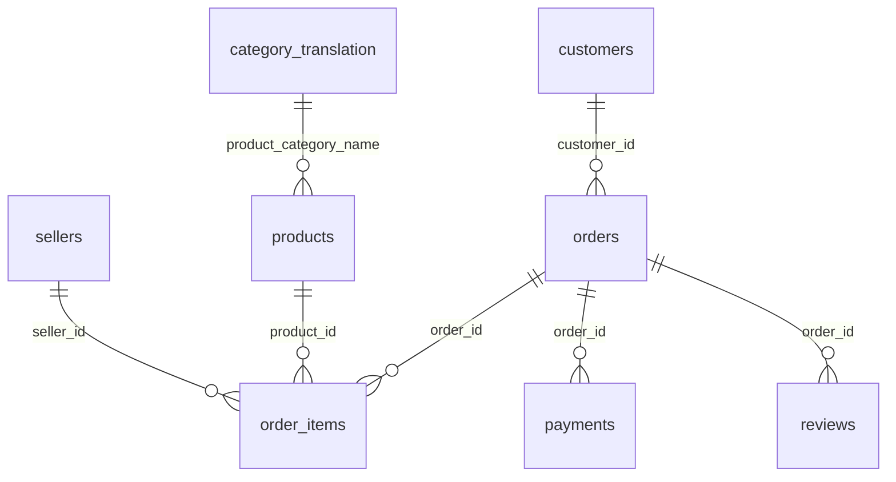

# Olist 巴西电商经营分析

> 用 9.9 万笔真实订单，回答三个问题：**生意长什么样、钱漏在哪里、该先修哪里。**

一次完整的电商经营分析：从 MySQL 建表导入、SQL 指标体系搭建，到 Python 探索性分析、FineBI 可视化看板，最终落到一份可执行的治理方案。


---

## TL;DR

| 结论 | 数据 |
|---|---|
| 规模：两年做到 **R$ 1,541.8 万** GMV、9.65 万笔交付订单，客单价 R$ 159.83 | 2016.09 – 2018.08 |
| 增长：2017.01 的 12.7 万 → 2018.08 的 98.5 万，**7.7 倍**；2017-11 黑五冲到峰值 115 万 | 处于平台期前的高速增长 |
| 结构：**71 个品类里前 5 个吃掉 40.4% GMV**；**SP 一州占 37.4%**，前 5 州占 73.2% | 高度集中 |
| 用户：**复购率 3.0%**，90 日留存 1.28% —— 一门靠拉新驱动的生意 | 93,350 名客户 |
| 体验：延迟订单差评率 **54.05%**，是准时件（9.22%）的 **5.9 倍**；评分在延迟第 3 天后断崖 | 8.11% 订单延迟 |
| 抓手：**RJ / BA / CE 三州 + 145 个问题卖家**，是性价比最高的两个治理入口 | 区域矩阵 + 卖家分层 |

---

## 1. 背景与问题

Olist 是巴西的电商平台型公司（marketplace）：卖家入驻、平台撮合、物流履约。它的数据是电商分析里少见的「全链路」样本——下单、支付、发货、配送、评价，每个环节都能对上。

拿到数据时，业务方真正关心的不是「GMV 多少」，而是：

1. **增长质量**：GMV 在涨，是靠拉新还是靠复购？结构是否健康？
2. **体验风险**：巴西物流以慢著称，延迟到底伤了多少口碑？伤到什么程度？
3. **资源投放**：只能改三个区域 / 三类卖家，投哪里回报最高？

## 2. 数据与建模

### 2.1 表结构

9 张原始表，围绕订单构建星型模型（本次分析使用 8 张，地理表用于看板）：



| 表 | 行数（清洗前） | 行数（清洗后） | 说明 |
|---|---:|---:|---|
| orders | 99,441 | 96,476 | 剔除签收时间异常/缺失 |
| order_items | 112,650 | 112,650 | 调整字段类型 |
| customers | 99,441 | 99,441 | 无缺失 |
| order_payments | 103,866 | 103,866 | 无缺失 |
| order_reviews | 99,224 | 99,224 | **一单可多评** |
| products | 32,951 | 32,340 | 删除品类缺失 610 条、尺寸缺失 2 条 |
| sellers | 3,095 | 3,095 | 无缺失 |
| category_translation | 71 | 71 | 品类中英映射 |

### 2.2 清洗与门槛

- 时间字段统一转 `datetime`；删除 `price ≤ 0` / `运费 < 0` 的异常明细；
- 交付口径统一为 `order_status = 'delivered'`；
- **一单多评**按评价时间取最新一条；
- 样本量门槛：州级分析 ≥100 单、卖家级 ≥15 单，避免小样本噪声。

> 最容易踩的坑：`customer_id` 是「一次下单的会话 ID」，同一自然人会有多个；算复购、RFM、留存必须用 `customer_unique_id`。

## 3. 分析框架

```
经营总览 → 增长趋势 → 结构拆解 → 用户价值 → 履约体验 → 归因落地
  GMV/客单价   月度趋势    品类/地域    复购/RFM/留存  延迟→差评   区域矩阵 + 卖家分层
```

技术栈：**MySQL 8.0**（建表、索引、多表关联、窗口函数、CTE）+ **Python**（pandas 清洗、seaborn 可视化）+ **FineBI**（区域治理看板）。

## 4. 关键发现

### 4.1 规模与增长

- 交付订单 **96,470** 笔，GMV **R$ 15,418,395**，客单价 **R$ 159.83**
- 运费占 GMV **14.26%** —— 一个被低估的成本杠杆
- 2017.01 → 2018.08，月 GMV 从 **12.7 万** 涨到 **98.5 万**（7.7 倍）
- **2017-11 黑五** 单月 115 万，为全期峰值；2018 年起进入 97–113 万的平台期
- 支付方式：信用卡占 **75.2%** 订单、**78.3%** 金额，平均分期 3.5 期；boleto（巴西票据支付）占 19.5%

### 4.2 高度集中的结构


- **71 个在售品类**，前 5 个贡献 **40.4%** GMV：health_beauty(9.4%)、watches_gifts(8.9%)、bed_bath_table(7.8%)、sports_leisure(7.3%)、computers_accessories(6.8%)
- 品类客单价差异明显：watches_gifts 达 **R$ 212**，是 health_beauty（R$ 143）的 1.5 倍
- 地域更极端：**SP 州占 37.4%**，RJ 13.3%、MG 11.8%，前 5 州合计 **73.2%**

### 4.3 一次性生意：复购与留存

| 指标 | 数值 | 解读 |
|---|---:|---|
| 客户数 | 93,350 | 交付口径 |
| 复购率 | **3.0%** | 仅 2,801 人下过第二单；97% 只买 1 次，2.76% 买 2 次 |
| 人均订单数 | 1.03 | 几乎全是「一锤子买卖」 |
| 30 / 60 / 90 日留存 | 0.65% / 1.02% / 1.28% | 观察窗口 ≥90 天的 75,320 人 cohort |

留存低到 1% 不是数据错了，而是这类 marketplace 的业务特征：**用户买完就走，钱在拉新和转化上，不在留存上**。这也意味着任何「留存提升」方案都必须先证明它能覆盖获客成本。

### 4.4 延迟 = 差评


- 平均配送 **12.1 天**；**8.11%**（7,824 单）超出承诺时效
- 在有评价的 95,824 单里：准时 88,163 单（92.01%）差评率 **9.22%**、均分 4.29；延迟 7,661 单（7.99%）差评率 **54.05%**、均分 2.57
- **评分随延迟天数单调下降，第 3 天后断崖**：

| 到货情况 | 订单数 | 平均评分 |
|---|---:|---:|
| 提前 7 天以上 | 75,744 | 4.31 |
| 提前 3–7 天 | 9,429 | 4.19 |
| 提前 1–3 天 | 2,990 | 4.14 |
| 准时准点 | 1,280 | 4.03 |
| 延迟 1–3 天 | 1,852 | 3.29 |
| 延迟 4–7 天 | 1,748 | 2.10 |
| 延迟 7 天以上 | 2,781 | 1.70 |

- **88.9% 的订单提前 3 天以上送达** —— 说明 ETA 设定极其保守：既把延迟率压得很低，也可能让用户在下单页犹豫。这是一个明确的实验机会。

### 4.5 跨州是体验劣势的系统性来源

| 指标 | 同州 | 跨州 |
|---|---:|---:|
| 订单数（占比） | 34,571（36%） | 61,885（**64%**） |
| 延迟率 | **4.52%** | **8.03%**（1.78 倍） |
| 平均评分 | 4.27 | 4.09 |
| 差评率 | **10.34%** | **14.19%**（+3.85pp） |

四项指标方向一致，说明跨州订单的体验劣势不是噪声，而是结构性问题——**改善跨州链路是提升整体评分最大的单一杠杆**。

## 5. 归因与落地

### 5.1 RFM：先修正失效的 F 维度

标准 RFM 用 NTILE 把 F 分 5 档，但复购率只有 3%，`f_score` 几乎全落 1 分，完全没有区分度。

于是改成业务分段：`f=1 → 1 分`、`f=2 → 4 分`、`f>2 → 5 分`，让「买过一次」和「买过两次以上」真正拉开差距。

| 分层 | 用户数 | 用户占比 | GMV 占比 | 人均 GMV |
|---|---:|---:|---:|---:|
| 一般用户 | 49,160 | 52.7% | 59.6% | R$ 187 |
| **高价值流失用户** | 13,774 | 14.8% | **27.5%** | R$ 308 |
| 低价值流失用户 | 29,360 | 31.5% | 10.5% | R$ 55 |
| 高价值活跃用户 | 989 | 1.1% | 2.4% | R$ 372 |

**关键洞察**：近 1/4 的 GMV 握在「曾经买得多、但已经很久没来」的 1.4 万人手里。召回其中 5%（约 690 人），按人均 R$ 308 估算，就是约 **R$ 21 万** 的增量 GMV —— 比拉 1 万个新客便宜得多。

> 这里有个统计陷阱：如果按 join 后的明细行数 `count(*)` 统计，会得到「11 万人」这种超过客户总数的结果。RFM 必须去重到 `customer_unique_id`。

### 5.2 区域优先级矩阵


按「延迟率 × 订单量」把 24 个州（≥100 单）分成四档：

| 优先级 | 州 | 订单量 | 延迟率 | 平均分 | 判断 |
|---|---|---:|---:|---:|---|
| **P0** | RJ | 12,348 | 12.11% | 3.97 | 单量大 + 延迟高，第一优先 |
| **P0** | BA | 3,256 | 12.16% | 3.93 | — |
| **P0** | CE | 1,278 | 13.77% | 3.94 | 延迟率最高 |
| P1 | AL | 397 | 21.41% | 3.85 | 延迟最严重，但单量小 |
| P1 | MA / SE / PI | 716 / 335 / 476 | 17.5% / 15.2% / 13.9% | ≈3.9 | 东北部/北部，换承运商即可 |
| P2 | PA | 946 | 11.21% | 3.91 | 延迟不高但评分低，查商品/卖家质量 |
| P3 | **SP** | 40,489 | **4.50%** | 4.25 | 单量最大反而最健康 |

> 这张矩阵推翻了一个直觉：**不是单量最大的 SP 最该救，而是 RJ/BA/CE。**
> P0 三州合计 16,882 单、2,067 单延迟；若压到 SP 的 4.5% 水平，可减少约 **1,300 单延迟**，按 54% 差评率折算 ≈ **减少 700 条差评**。

### 5.3 卖家分层

按「订单量 × 评分 × 延迟率」把 2,970 个有单卖家分成四层：

| 分层 | 卖家数 | GMV 占比 | 平均评分 | 延迟率 | 治理动作 |
|---|---:|---:|---:|---:|---|
| **明星卖家** | 290 | 27.2% | 4.39 | 3.6% | 流量倾斜、费率优惠、金牌标识 |
| **问题卖家** | 145 | 11.6% | 3.64 | 13.3%（差评率 26.7%） | 限期整改、降权、清退 |
| 常规卖家 | 369 | 44.1% | — | — | 常规运营 |
| 长尾卖家（<20 单） | 2,166 | 17.2% | 4.16 | — | 引导合并 / 自然淘汰 |

**145 个问题卖家只占 4.9% 的卖家数，却贡献 11.6% 的 GMV**——这意味着治理不能一刀切清退，否则会伤到营收；正确做法是先整改、再决定去留。

## 6. 业务建议

### P0 · 物流时效治理

1. **区域治理**：在东北部 / 北部（CE、BA、MA、AL）布局或前置仓，优化配送路线，优先覆盖 RJ/BA/CE 三州。
2. **订单预警**：对预计超时订单提前 24 小时通知客户，附 R$ 5–10 优惠券或免运费券；把延迟尽量压在 3 天内（3 天是评分断崖点）。
3. **跨州 ETA 分层**：按「卖家州 × 买家州」设置承诺时效，而不是全国统一——跨州延迟率是同州的 1.78 倍，承诺时间应该体现这个差异。

### P1 · 客户留存

4. **RFM 分层运营**：高价值活跃用户给 VIP 权益与专属客服；高价值流失用户用大额券 + 电话回访召回。
5. **首购后 30 天培育**：第 3 / 7 / 14 / 30 天推送关联品类推荐 + 复购券；对高评分客户请求评价（评价是低成本的口碑资产）。

### P1 · 卖家治理

6. **问题卖家**（≥20 单且评分 <3.5 / 差评率 >20% / 延迟率 >20%）：限期整改、降权，连续两期未达标清退。
7. **明星卖家**（≥20 单、GMV 高、评分 ≥4）：流量倾斜、费率优惠、新品优先，授予「金牌卖家」。
8. **长尾卖家**（<20 单且 GMV 低）：引导合并或自然淘汰，连续 6 个月低绩效限制上新，控制平台治理成本。

### P2 · 值得做实验的两件事

9. **ETA 收紧实验**：88.9% 的订单提前 3 天以上送达，说明承诺时效过于保守。试点把 ETA 收紧 1–2 天，观察转化率提升是否覆盖延迟率上升。
10. **分期免息实验**：信用卡平均 3.5 期分期，对高客单品类（watches_gifts）试点免息，验证客单价弹性。

## 7. FineBI 看板


看板支持「州 → 城市 → 卖家」逐层下钻：

- 指标卡：GMV / 订单量 / 延迟率 / 差评率 / 平均评分
- 地图：各州延迟率热力 + 优先级着色（P0 红 / P1 橙 / P2 黄 / P3 绿）
- 明细：延迟率 Top 卖家、跨州链路矩阵

🔗 在线看板：<https://pcdemo.finebi.com/webroot/decision/v5/design/report/929aea2684f54d539ac0050ed0b2cfd/view>

## 8. 项目结构

```
.
├── README.md
├── assets/                      # README 配图
├── sql/
│   ├── 01_create_tables.sql     # 建库建表、索引、数据导入
│   ├── 02_analysis.sql          # GMV/品类/地域/支付/RFM/归因/区域矩阵
│   └── 03_retention.sql         # 留存与同期群
├── notebook/
│   └── olist_eda.ipynb          # 数据预览、清洗、可视化
└── data/                        # 原始 CSV（不入库）
```

> 对应现有的 `olist建表.sql` / `olist数据分析.sql` / `olist留存分析.sql` / `olist电商数据分析.ipynb`，建议按 01/02/03 编号重命名，顺序即执行顺序。

## 9. 如何复现

```bash
# 1. 数据
# Kaggle: Brazilian E-Commerce Public Dataset by Olist（9 个 CSV）

# 2. 建库导入（MySQL 8.0）
mysql -u root -p < sql/01_create_tables.sql
# 注意：脚本里的 load data local infile 路径要改成你本机的路径
# 且需开启 set global local_infile = 1;

# 3. 跑分析
mysql -u root -p olist < sql/02_analysis.sql
mysql -u root -p olist < sql/03_retention.sql

# 4. Notebook
pip install pandas numpy matplotlib seaborn sqlalchemy pymysql
jupyter notebook notebook/olist_eda.ipynb
```

## 10. 口径说明

| 概念 | 口径 |
|---|---|
| 营收 / GMV | 交付订单的 `price + freight_value` 之和 |
| 客单价 | GMV ÷ 交付订单数 |
| 客户 | `customer_unique_id` 去重后的人数（不是 `customer_id`） |
| 差评 | `review_score ≤ 2`，一单多评取最新一条 |
| 延迟 | 实际签收时间 > 承诺送达时间 |
| 延迟率 | 延迟订单数 ÷ 交付订单数（订单口径，非卖家口径） |
| 复购率 | `customer_unique_id` 下 ≥2 笔交付订单的用户占比 |
| 留存 | 首单后 N 天内有再次购买，仅统计观察窗口 ≥90 天的 cohort |
| 月度趋势 | 按**下单时间**归月，不是按发货期限 `shipping_limit_date` |
| 支付占比 | 按订单去重统计；一单多笔支付（如「券 + 信用卡」）会拆成多行，按行数算会高估券的占比 |

## 11. 局限与下一步

- **无成本与利润数据**，只能做营收侧分析，无法算真实 ROI；
- **归因为相关性**：延迟与差评高度相关，但严格因果需要实验或工具变量，本分析不做因果结论；
- **时间窗口 2016.09–2018.08**，之后的结构已变化；
- 下一步：把 ETA 调整与区域承运商切换做成 AB 实验，验证延迟率下降对差评率的真实弹性。

---

作者：肖智星 ｜ 数据来源：[Kaggle - Brazilian E-Commerce Public Dataset by Olist](https://www.kaggle.com/datasets/olistbr/brazilian-ecommerce) ｜ 代码仓库：[X-zhixing/Olist-E-commerce-Data-Analysis](https://github.com/X-zhixing/Olist-E-commerce-Data-Analysis)
