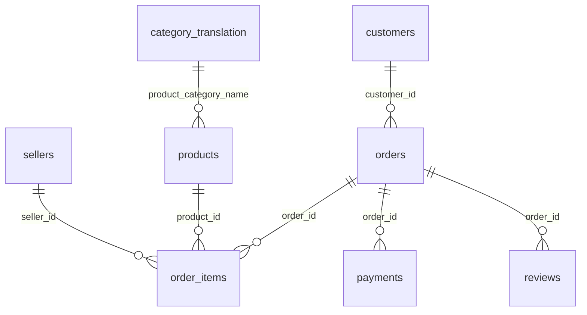

# Olist 巴西电商经营分析

> 用 9.9 万笔真实订单，回答三个问题：**生意长什么样、钱漏在哪里、该先修哪里。**

一次完整的电商经营分析：从 MySQL 建表导入、SQL 指标体系搭建，到 Python 探索性分析、可视化看板，最终落到一份可执行的治理建议。


---

## TL;DR

| 结论 | 数据 |
|---|---|
| 规模：两年做到 **R$ 1,542 万** GMV、9.6 万笔交付订单，客单价 R$ 159.8 | 2016.09 – 2018.08 |
| 增长：2017.01 的 12.7 万 → 2018.08 的 98.5 万，**7.7 倍**；2017-11 黑五冲到峰值 115 万 | — |
| 结构：**71 个品类里前 5 个吃掉 40.4% GMV**；**SP 一个州占 37.4%**，前 5 州占 73.2% | 高度集中 |
| 用户：**复购率 3.0%**，90 日留存 1.28% —— 这是一门靠拉新驱动的生意 | 93,358 名客户 |
| 体验：延迟订单差评率 **54.05%**，是准时件（9.22%）的 **5.9 倍** | 8.11% 订单延迟 |
| 抓手：RJ / BA / CE 三州合计 1.69 万单、延迟率 12%–14%，是**最该先治的区域** | 优先级矩阵 P0 |

---

## 1. 背景与问题

Olist 是巴西的电商平台型公司（marketplace）：卖家入驻、平台撮合、物流履约。它的数据是电商分析里少见的「全链路」样本——从下单、支付、发货、配送到评价，每个环节都能对上。

拿到数据时，业务方真正关心的不是「GMV 多少」，而是：

1. **增长质量**：GMV 在涨，是靠拉新还是靠复购？结构是否健康？
2. **体验风险**：巴西的物流以慢著称，延迟到底伤了多少口碑？
3. **资源投放**：如果只能改三个区域，改哪里回报最高？

## 2. 数据与建模

### 2.1 表结构

9 张原始表，围绕订单构建星型模型：



| 表 | 行数 | 说明 |
|---|---:|---|
| orders | 99,441 | 订单主表，含下单/审核/发货/签收/预计送达 5 个时间戳 |
| order_items | 112,650 | 订单明细，含价格与运费 |
| customers | 99,441 | 客户，`customer_unique_id` 才是自然人 |
| payments | 103,886 | 支付流水，一单可多笔 |
| reviews | 99,224 | 评价，**一单可多评** |
| products | 32,951 | 商品，含品类与尺寸重量 |
| sellers | 3,095 | 卖家 |
| geolocation | 1,000,163 | 邮编级经纬度 |

### 2.2 清洗规则

| 问题 | 处理 | 影响 |
|---|---|---|
| 签收时间缺失 / 状态非交付 | 剔除 2,963 条（3.0%） | orders 99,441 → **96,478** 笔交付订单（97.0%） |
| 商品品类缺失 610 条(1.85%)、尺寸缺失 2 条 | 剔除 | products 32,951 → **32,340** |
| `product_photos_qty` 缺失 | 填 0 | — |
| **一单多评** | 按评价时间取最新一条 | 99,224 → 98,763 个订单去重 |
| 时间字段为字符串 | 转 datetime 后再算时效 | 避免字符串比较错误 |

> 关键一点：`customer_id` 是「一次下单的会话 ID」，同一自然人会有多个；算复购、RFM、留存必须用 `customer_unique_id`。这是这张数据集最容易踩的坑。

## 3. 分析框架

```
经营总览 → 增长趋势 → 结构拆解 → 用户价值 → 履约体验 → 归因落地
  GMV/客单价   月度趋势    品类/地域    复购/RFM/留存  延迟→差评   区域优先级矩阵
```

技术栈：**MySQL 8.0**（建表、索引、多表关联、窗口函数、CTE）+ **Python**（pandas 清洗、seaborn 可视化）+ **FineBI**（区域治理看板）。

## 4. 关键发现

### 4.1 规模与增长

- 交付订单 **96,478** 笔，GMV **R$ 15,419,774**，客单价 **R$ 159.83**
- 运费占 GMV **14.26%** —— 这是一个被低估的成本杠杆
- 2017.01 → 2018.08，月 GMV 从 **12.7 万** 涨到 **98.5 万**（7.7 倍）
- **2017-11 黑五** 单月冲到 115 万，是全年峰值；2018 年起进入平台期（97–113 万区间震荡）

### 4.2 高度集中的结构


- **71 个在售品类**，前 5 个贡献 **40.4%** GMV：health_beauty(9.4%)、watches_gifts(8.9%)、bed_bath_table(7.8%)、sports_leisure(7.3%)、computers_accessories(6.8%)
- 地域更极端：**SP 州占 37.4%**，RJ 13.3%、MG 11.8%，前 5 州合计 **73.2%**
- 含义：大促资源、仓配布局、客服排班都应该围绕这 5 个州做，而不是全国平铺

### 4.3 一次性生意：复购与留存

| 指标 | 数值 | 解读 |
|---|---:|---|
| 客户数 | 93,358 | 交付口径 |
| 复购率 | **3.0%** | 仅 2,801 人下过第二单 |
| 人均订单数 | 1.03 | 几乎全是「一锤子买卖」 |
| 30 / 60 / 90 日留存 | 0.65% / 1.02% / 1.28% | 观察窗口 ≥90 天的 75,320 人 cohort |

留存低到 1% 不是数据错了，而是这类 marketplace 的业务特征：**用户买完就走，平台的钱在拉新和转化上，不在留存上**。所以 RFM 的 F 维度几乎失效——见 5.1 的处理。

### 4.4 延迟 = 差评


- 平均配送时长 **12.1 天**，**8.11%**（7,824 单）超出承诺时效
- 在有评价的订单里，延迟件差评率 **54.05%**（7,661 单），准时件 **9.22%**（88,171 单），**5.9 倍**差距；平均评分 2.57 vs 4.29
- 跨州订单占 **64.2%**，差评率 **14.18%**，同州仅 **10.34%**
- 整体差评率（≤2 星）**12.81%**，平均分 4.16，5 星占 59.2%

**一句话：物流时效是这家公司口碑的第一变量，而且是可控的。**

## 5. 归因与落地

### 5.1 RFM 的一个修正

标准 RFM 用 NTILE 把 F 分成 5 档，但复购率只有 3%，分层后 `f_score` 几乎全落在 1 分，完全没有区分度。

于是改成业务分段：`f=1 → 1 分`、`f=2 → 4 分`、`f>2 → 5 分`，让「买过一次」和「买过两次以上」真正拉开差距。

| 分层 | 用户数 | 用户占比 | GMV 占比 | 人均 GMV |
|---|---:|---:|---:|---:|
| 一般用户 | 49,160 | 52.7% | 59.6% | R$ 187 |
| **高价值流失用户** | 13,774 | 14.8% | **27.5%** | R$ 308 |
| 低价值流失用户 | 29,360 | 31.5% | 10.5% | R$ 55 |
| 高价值活跃用户 | 989 | 1.1% | 2.4% | R$ 372 |

**关键洞察**：近 1/4 的 GMV 握在「曾经买得多、但已经很久没来」的 1.4 万人手里。召回其中 5%（约 690 人），按人均 R$ 308 估算，就是约 **R$ 21 万** 的增量 GMV——比拉 1 万个新客便宜得多。

### 5.2 区域优先级矩阵

按「延迟率 × 订单量」把 24 个州（订单量 ≥100）分成四档：

| 优先级 | 州 | 订单量 | 延迟率 | 平均分 | 说明 |
|---|---|---:|---:|---:|---|
| **P0** | RJ | 12,348 | 12.11% | 3.97 | 单量大 + 延迟高，第一优先 |
| **P0** | BA | 3,256 | 12.16% | 3.93 | — |
| **P0** | CE | 1,278 | 13.77% | 3.94 | 延迟率最高 |
| P1 | AL | 397 | 21.41% | 3.85 | 延迟最严重，但单量小 |
| P1 | MA / SE / PI | 716 / 335 / 476 | 17.5% / 15.2% / 13.9% | ≈3.9 | 同上 |
| P2 | PA | 946 | 11.21% | 3.91 | 延迟不高但评分低，查商品/卖家质量 |
| P3 | **SP** | 40,489 | **4.50%** | 4.25 | 单量最大反而最健康 |

> 这张矩阵直接推翻了一个直觉：**不是单量最大的 SP 最该救，而是 RJ/BA/CE 三州。**
> P0 三州合计 16,882 单、2,067 单延迟；若把延迟率压到 SP 的 4.5% 水平，可减少约 **1,300 单延迟**，按 54% 差评率折算 ≈ **减少 700 条差评**。

## 6. 业务建议

1. **区域分级治理（P0 先行）**：RJ / BA / CE 三州试点「超时预警 + 备用承运商 + 跨州订单时效 +2 天」；AL / MA 等低单量高延迟州用轻量方案（换承运商即可）。
2. **跨州订单的承诺时效**：64% 的订单跨州，跨州订单差评率比同州高 **3.8pp**。建议按「卖家州 × 买家州」分层设置 ETA，而不是全国统一，从源头减少「被判延迟」。
3. **高价值流失用户召回**：对 13,774 名高价值流失用户做定向触达（邮件 + 优惠券），优先覆盖最近一次购买在 180–360 天的人群。
4. **大促资源集中**：health_beauty、watches_gifts、bed_bath_table 三类合计 26.2% GMV，且 watches_gifts 客单价最高（R$ 212），适合做黑五主推位。
5. **支付体验**：信用卡占 75.3%、平均 3.5 期分期，boleto（巴西票据支付）占 19.5% 但存在未支付风险，可对分期免息做 AB 实验。

## 7. 看板

FineBI 搭建区域治理看板，支持从「州 → 城市 → 卖家」逐层下钻：

- 指标卡：GMV / 订单量 / 延迟率 / 差评率 / 平均评分
- 地图：各州延迟率热力 + 优先级着色
- 明细：延迟率 Top 卖家、跨州链路矩阵

> 把 FineBI 导出的看板截图放到 `assets/dashboard.png` 即可在此展示。

## 8. 项目结构

```
.
├── README.md
├── assets/                      # README 配图
├── sql/
│   ├── 01_create_tables.sql     # 建库建表、索引、数据导入
│   ├── 02_analysis.sql          # GMV/品类/地域/支付/RFM/归因/区域矩阵
│   └── 03_retention.sql         # 留存与同期群
├── notebook/
│   └── olist_eda.ipynb          # 数据预览、清洗、可视化
└── data/                        # 原始 CSV（不入库）
```

> 对应现有的 `olist建表.sql` / `olist数据分析.sql` / `olist留存分析.sql` / `olist电商数据分析.ipynb`，建议按 01/02/03 编号重命名，顺序即执行顺序。

## 9. 如何复现

```bash
# 1. 数据
# Kaggle: Brazilian E-Commerce Public Dataset by Olist（9 个 CSV）

# 2. 建库导入（MySQL 8.0）
mysql -u root -p < sql/01_create_tables.sql
# 注意：脚本里的 load data local infile 路径要改成你本机的路径
# 且需开启 set global local_infile = 1;

# 3. 跑分析
mysql -u root -p olist < sql/02_analysis.sql
mysql -u root -p olist < sql/03_retention.sql

# 4. Notebook
pip install pandas numpy matplotlib seaborn sqlalchemy pymysql
jupyter notebook notebook/olist_eda.ipynb
```

## 10. 口径说明

分析结论的可信度取决于口径，这里把关键定义写清楚：

| 概念 | 口径 |
|---|---|
| GMV | 交付订单的 `price + freight_value` 之和 |
| 客单价 | GMV ÷ 交付订单数 |
| 差评 | `review_score ≤ 2`，一单多评取最新一条 |
| 延迟 | 实际签收时间 > 承诺送达时间 |
| 复购率 | `customer_unique_id` 下 ≥2 笔交付订单的用户占比 |
| 留存 | 首单后 N 天内有再次购买，仅统计观察窗口 ≥90 天的 cohort |
| 延迟率 | 延迟订单数 ÷ 交付订单数（订单口径，非卖家口径） |

## 11. 局限与下一步

- **无成本与利润数据**，只能做营收侧分析，无法算真实 ROI；
- **归因为相关性**：延迟与差评高度相关，但严格因果需要实验或工具变量，本分析不做因果结论；
- **时间窗口 2016.09–2018.08**，之后的数据结构已变化；
- 下一步：把「区域 ETA 调整」做成 AB 实验（分流到州 × 承运商），验证延迟率下降对差评率的真实弹性。

---

作者：肖智星 ｜ 数据来源：[Kaggle - Brazilian E-Commerce Public Dataset by Olist](https://www.kaggle.com/datasets/olistbr/brazilian-ecommerce)
